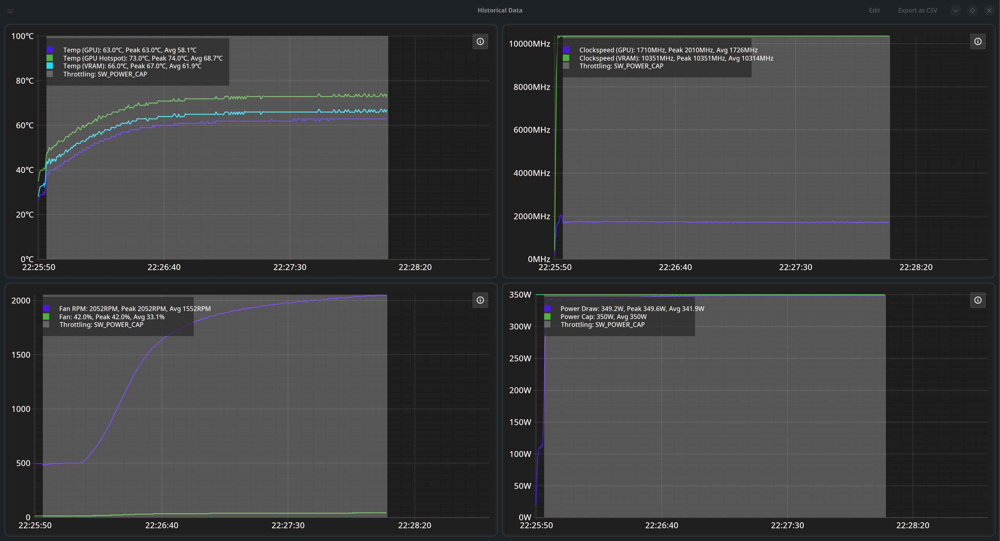

# RTX 3090 Blower VBIOS

Quiet Fan and Resizable BAR support for the Zotac RTX 3090 blower on Linux.

## Features

- **Resizable BAR:** an experimental boot profile exposes a 32 GiB BAR1 aperture without flashing the GPU.
- **Fan curve:** lowers idle fan settings and starts the automatic fan ramp at 45°C.
- **GPU unlock:** supports the `gpu-unlock` kernel module and its firmware for the tested Ampere card.
- **Recovery:** keeps the existing boot entry available as a fallback.

## Tested hardware

- GPU: Zotac RTX 3090 blower, `10de:2204/19da:1625`.
- PCI address: `0000:07:00.0`.
- NVIDIA open driver: `620.73.04`.
- ReBAR: Linux allocated 32 GiB BAR1 and LACT reported enabled on one test boot.
- Fan: LACT reported around 500 RPM at idle with the edited profile.
- Full CPU access to VRAM, repeat boots, sustained workloads and other cards remain unverified.

The scripts and PCI IDs are specific to this configuration. Check your card and paths before use. Keep a backup of the original ROM and a working boot entry. Do not flash the edited ROM.

## Fan curve

Both fan channels use these settings:

| Setting                 | Original  | Profile   |
| ----------------------- | --------- | --------- |
| Minimum speed           | 3,000 RPM | 1,000 RPM |
| Minimum level           | 60%       | 10%       |
| First curve temperature | 55°C      | 45°C      |
| First curve speed       | 3,000 RPM | 1,000 RPM |
| First curve level       | 60%       | 10%       |

- Higher curve points and extra curves remain unchanged.
- Actual fan speed and cooling depend on the card and environment.
- Verify physical fan startup, GPU temperature, hotspot and VRAM temperature under sustained load.

### Create and load

1. Back up the original ROM with `src/extract.bash` or the `src/extract-tty3.bash` console workflow. Check the NVFlash adapter index first; the tested card used index 0. The save required unloaded NVIDIA modules and `iomem=relaxed` on this system.
2. Create the profile and its relocated loader payload:

   ```bash
   bash ./src/edit.bash ORIGINAL.rom EDITED.rom
   ```

3. Load the generated `EDITED-loader.bin` as an in-memory VBIOS override. With no kernel argument, this uses the running kernel:

   ```bash
   bash ./src/load.bash ./EDITED-loader.bin
   ```

   To build overrides for multiple installed kernels, list their full releases. The first is selected by the loader:

   ```bash
   bash ./src/load.bash ./EDITED-loader.bin 7.3.5-2-cachyos-bore 7.3.3-2-cachyos-bore
   ```

   Use your installed kernel releases and ensure matching headers and NVIDIA DKMS dependencies are installed. The script uses the installed `/usr/local/bin/nvbios`; the loader must support the kernels and GRUB configuration on the machine. Some kernels and boot configurations require the local loader's GRUB parsing and Clang LTO fixes.

4. Reboot and inspect the loader and fan behavior:

   ```bash
   sudo nvbios system status
   journalctl -k -b | rg -i 'vbios.override|vbios_override'
   ```

- Enrollment replaces the existing GPU profile. The script removes the kernel-package restriction and retains two generations for one selected kernel or three for multiple kernels.
- Retention is global across kernels, not per kernel. After a matching boot, verify that every desired entry remains available; custom ReBAR entries can also prevent removal of referenced generations.
- The loader checks hashes of managed GRUB entries; do not rename or delete them directly.
- After changing the VBIOS override or kernel, rebuild and install a separate ReBAR entry for each kernel. The loader does not update those images automatically.
- Matching module parameters do not by themselves prove the fan settings took effect.

### Observed load run

- Duration: approximately two minutes.
- Fan: about 500 to 2,052 RPM.
- Peak power: 349.6 W.
- Peak temperatures: GPU 63°C, hotspot 74°C, VRAM 67°C.
- LACT reported the software power cap in the displayed throttling status.
- This short run does not establish startup reliability or sustained performance.



## Resizable BAR

The ReBAR profile uses a separate initramfs and GRUB entry. It performs a volatile PCI resize before the NVIDIA driver loads; it does not flash the VBIOS. The 32 GiB aperture is not additional physical VRAM.

### Requirements

- Arch-style `mkinitcpio`, systemd, `lsinitcpio`, `cpio`, `zstd`, `setpci` and GRUB tools.
- A known-working loader-managed initramfs containing `gpu_unlock`, its firmware, the patched NVIDIA modules and the fan override.
- A [geforce-bar1-resize](https://github.com/noon-at-cgn/geforce-bar1-resize) checkout. The builder checks that its script has SHA-256 `da12bcbb3bc4811264695ce1e0dd24aea340cb3a6ba27f03a44d76bec051d737`.
- The checkout defaults to `~/GitHub/geforce-bar1-resize-rebar-work`; pass another path as the builder’s fourth argument.
- Review the card address and IDs in `src/rebar/` before building.

### Build for each kernel

Copy that kernel's **known-working managed** initramfs and GRUB entry to a private directory. Identify its generation from `sudo nvbios system status` and `/boot/grub/nvidia-vbios-entries/`. Repeat with a different output directory for every kernel.

```bash
kernel=7.3.5-2-cachyos-bore
generation=vbios-7.3.5-2-cachyos-bore-REPLACE_WITH_YOUR_GENERATION
install -d -m 700 "rebar-boot-work/$kernel-input"
sudo install -m 600 -o "$(id -u)" -g "$(id -g)" \
	"/boot/nvidia-vbios/$generation/initramfs.img" \
	"rebar-boot-work/$kernel-input/fallback-initramfs.img"
sudo install -m 600 -o "$(id -u)" -g "$(id -g)" \
	"/boot/grub/nvidia-vbios-entries/$generation.cfg" \
	"rebar-boot-work/$kernel-input/fallback.cfg"
REBAR_KERNEL="$kernel" bash src/build-rebar.bash \
	"rebar-boot-work/$kernel-input/fallback-initramfs.img" \
	"rebar-boot-work/$kernel-input/fallback.cfg" "rebar-boot-work/$kernel-build"
```

- The builder appends a compressed archive, checks its contents and creates a separate GRUB entry. It does not modify `/boot`.
- `lsinitcpio` may show only the first archive; the builder checks the appended archive independently.
- Review `rebar.cfg` and `SHA256SUMS` in the output directory.
- The default entry ID and image directory include the kernel release. `REBAR_ENTRY_ID` and `REBAR_BOOT_DIR` can override them when another generation must coexist.

### Install and verify

```bash
sudo bash src/install-rebar.bash "rebar-boot-work/$kernel-build"
```

- Installation verifies the fallback entry and image, preserves and backs up existing custom entries, and refuses to overwrite an existing ReBAR image or entry ID.
- Confirm your GRUB configuration sources `custom.cfg` and check the saved default with `sudo grub-editenv /boot/grub/grubenv list`.
- Reboot and select **CachyOS NVIDIA ReBAR (kernel release)**. The saved default is not changed by installation.
- Check `/proc/cmdline`, `lspci -vv -s 07:00.0`, LACT and `nvidia-smi` after boot.
- If there is a problem, reboot into the existing VBIOS override or normal entry.
- Keep the fallback image and entry until recovery and workloads are tested.
- The optional `RMForceStaticBar1=0` setting was not used in the successful test boot.

## GPU unlock

- Install the AUR firmware and DKMS packages with `paru` or `yay`:

  ```bash
  bash src/install-gpu-unlock.bash
  ```

- Run the script as a normal user; the AUR helper requests elevated privileges when needed.
- Package installation alone does not enable the unlock. Follow the [gpu-unlock project](https://github.com/Zagitta/gpu-unlock) for boot configuration, initramfs rebuilds and verification.
- The tested boot used `gpu_unlock.targets=all`; review its effect on all supported GPUs before using that setting.
